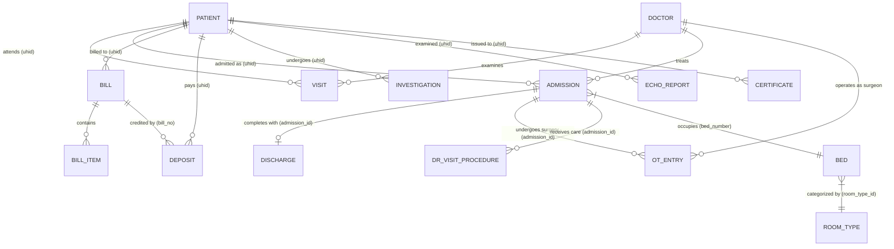

# 06 — JSON STORAGE DATA RELATIONSHIP & INTEGRITY AUDIT
**Mixu Infosystem Hospital Management / EMR System**
*Generated: 2026-11-16 | Relational Schema Mapping for Future MySQL Migration*

---

## 1. Relational Integrity Architecture

Although the application operates with zero external SQL database engines during this phase—storing all state in OS-locked JSON files—the data schema is strictly normalized. Every entity includes explicit foreign key relationships, ensuring a painless 1-to-1 migration to MySQL tables in the future.

---

## 2. Entity-Relationship Schema Map

---

## 3. Key Cross-Entity Foreign Keys

| Parent Entity | Parent PK | Child Entity | Child FK Field | Integrity Constraint |
|---------------|-----------|--------------|----------------|----------------------|
| `patients.json` | `uhid` | `patient_visits.json` | `uhid` | Mandatory |
| `patients.json` | `uhid` | `admissions.json` | `uhid` | Mandatory |
| `patients.json` | `uhid` | `bills.json` | `uhid` | Mandatory |
| `patients.json` | `uhid` | `deposits.json` | `uhid` | Mandatory |
| `patients.json` | `uhid` | `investigations.json` | `uhid` | Mandatory |
| `patients.json` | `uhid` | `echo_reports.json` | `uhid` | Mandatory |
| `patients.json` | `uhid` | `certificates.json` | `uhid` | Mandatory |
| `admissions.json` | `id` / `ipd_no` | `discharges.json` | `admission_id` / `ipd_no` | Unique 1-to-1 |
| `admissions.json` | `id` / `ipd_no` | `ot_entries.json` | `admission_id` / `ipd_no` | 1-to-Many |
| `admissions.json` | `bed_number` | `beds.json` | `bed_number` | Active occupancy |
| `bills.json` | `billNo` | `deposits.json` | `receipt_no` / `bill_no` | Ledger balance |
| `doctors.json` | `name` | `patient_visits.json` | `doctor` | Name normalization |
| `medicines.json` | `id` | `prescription_templates`| `medicine_id` | Catalog lookup |

---

## 4. Concurrency & File Lock Architecture

To prevent race conditions, dirty writes, and file corruption when multiple requests read or modify JSON files simultaneously:
- **Backend OS File Locking**:
  - Implemented using Python's `msvcrt.locking` on Windows (and `fcntl.flock` on Unix).
  - Every write operation creates an atomic `.lock` file, acquires an exclusive write lock, flushes data with atomic rename, and safely releases the lock.
- **Client Offline Synchronization**:
  - On static deployment platforms (GitHub Pages), client write operations update `localStorage` and trigger instant in-memory state updates, preserving data persistence across page reloads.
