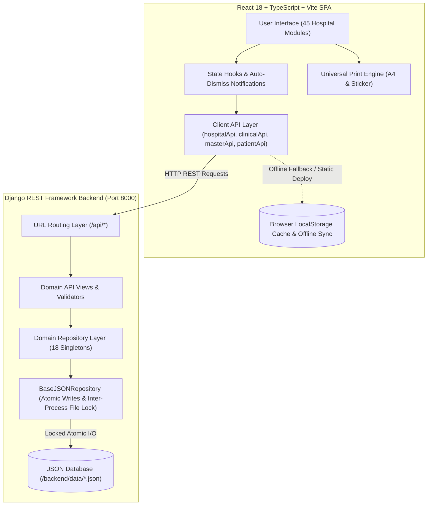

# 01. Project Implementation Overview

## Mixu Infosystem Hospital Management / EMR System
**Architecture Phase: Fully Functional JSON-Backed Enterprise EMR (MySQL-Ready)**

---

### 1. Executive Summary

The **Mixu Infosystem Hospital Management / EMR** application is a modern, high-aesthetic, responsive, web-based healthcare software system designed for multi-department hospitals and clinics.

To support rapid deployment, zero external database setup friction, and local offline capability, the entire data tier is powered by a **structured, relational JSON Repository Architecture** in the Django REST backend, mirrored by a robust local storage and static JSON fallback in the React frontend.

The system is architected under strict **Separation of Concerns (SoC)**, ensuring that future migration to **MySQL** (or PostgreSQL) will require **zero rewrites** to frontend components, user interfaces, or API endpoints.

---

### 2. Full Architecture Topology

---

### 3. Core Design Principles

1. **Relational Data Modeling Over JSON**:
   - Entities have strict, predictable, sequential primary keys (`UHID-XXXX`, `ADM-XXXX`, `IPD-2026-XXXX`, `DIS-XXXX`, `ORD-XXXX`, `CERT-XXXX`, `REC-XXXX`).
   - Foreign keys link records across domain boundaries (e.g., `Admission.bed_number -> Bed.bed_number`, `Discharge.admission_id -> Admission.id`).
   - Timestamps are standardized in ISO-8601 Indian Standard Time (`+05:30`).

2. **Inter-Process Concurrency & Atomic Writes**:
   - Every file modification acquires an OS-level file lock (`msvcrt` on Windows, `fcntl` on Linux/macOS) to prevent race conditions across parallel requests.
   - Writes are executed using a temporary file (`NamedTemporaryFile`) followed by an atomic OS replace (`os.replace`), ensuring that a crash or interruption never corrupts persistent JSON files.

3. **Universal Healthcare Print System**:
   - No browser headers/footers or URL chrome in prints.
   - Pixel-perfect, high-aesthetic printable documents (Patient Sticker, Bill Cum Receipt, Echo Report, Admission Face Sheet, Discharge Card, Deposit Receipt, Lab Investigation, Medical/MLC/Death Certificates) themed with Mixu logo palette (`#4285F4`, `#EA4335`, `#FBBC05`, `#34A853`).

4. **MySQL Ready By Design**:
   - Business services interact exclusively with Repository interfaces (`get_all`, `get_by_id`, `create`, `update`, `delete`, `filter`, `search`).
   - When migrating to MySQL, developers simply provide a `BaseMySQLRepository` implementing the exact same interface methods.
