# 03. Data Model & Entity Relationships

## Mixu Infosystem Hospital Management / EMR System

---

### 1. Entity-Relationship Diagram (ERD)

The JSON data store implements relational integrity through stable primary keys and foreign keys:

```mermaid
erDiagram
    PATIENT ||--o{ PATIENT_VISIT : "has longitudinal visits"
    PATIENT ||--o{ ADMISSION : "admitted for inpatient stay"
    PATIENT ||--o{ INVESTIGATION : "ordered lab tests"
    PATIENT ||--o{ CERTIFICATE : "issued certificates"
    PATIENT ||--o{ ECHO_REPORT : "undergoes echo exams"
    
    DOCTOR ||--o{ ADMISSION : "admitting consultant"
    DOCTOR ||--o{ PATIENT_VISIT : "consults patient"
    DOCTOR ||--o{ DR_VISIT_PROCEDURE : "performs inpatient rounds"
    DOCTOR ||--o{ OT_ENTRY : "leads surgical procedure"
    
    ADMISSION ||--|| BED : "occupies/releases"
    ADMISSION ||--o| DISCHARGE : "concluded by discharge summary"
    ADMISSION ||--o{ DEPOSIT : "advances and part payments"
    ADMISSION ||--o{ DR_VISIT_PROCEDURE : "incurred rounds & procedures"
    ADMISSION ||--o{ OT_ENTRY : "undergoes surgery in OT"
    
    ROOM_TYPE ||--o{ BED : "classifies bed rate and ward"
    OPERATION_GROUP ||--o{ OT_ENTRY : "categorizes surgical group"
    INSURANCE_COMPANY ||--o{ ADMISSION : "provides cashless / TPA coverage"

    PATIENT {
        string id PK "UHID-XXXX"
        string uhid
        string name
        int age
        string gender
        string mobile
        string address
        string reg_date
    }

    PATIENT_VISIT {
        string id PK "VST-XXXXXX"
        int visit_no "1, 2, 3..."
        string uhid FK
        string doctor
        string visit_type
        json vitals "bp, pulse, temp, spo2"
        string chief_complaint
    }

    ADMISSION {
        string id PK "ADM-XXXXXX"
        string ipd_no "IPD-2026-XXXX"
        string uhid FK
        string bed_number FK
        string ward_name
        string room_type
        float daily_bed_charge
        string admitting_doctor
        string status "Admitted | Discharged | Transferred"
        string provisional_diagnosis
        float initial_deposit
    }

    BED {
        string id PK "BED-XXXXXX"
        string bed_number UK
        string ward_name
        string room_type_id FK
        string status "Vacant | Occupied | Maintenance"
        string current_admission_id FK
        float daily_rate
    }

    DISCHARGE {
        string id PK "DIS-XXXXXX"
        string discharge_no "DIS-2026-XXXX"
        string admission_id FK
        string ipd_no
        string uhid FK
        string discharge_date
        string condition_on_discharge "Recovered | Improved | LAMA | Referred | Deceased"
        string final_diagnosis
        string treatment_summary
        string discharge_medications
        string follow_up_instructions
    }

    DEPOSIT {
        string id PK "DEP-XXXXXX"
        string receipt_no "REC-2026-XXXX"
        string uhid FK
        string ipd_no FK
        string deposit_date
        float amount
        string payment_mode "Cash | Card | UPI | Cheque"
        string authorized_by
    }

    DR_VISIT_PROCEDURE {
        string id PK "DVP-XXXXXX"
        string admission_id FK
        string uhid FK
        string doctor_name
        string entry_type "Doctor Visit | Procedure"
        string head_description
        float rate
        int quantity
        float amount
    }

    OT_ENTRY {
        string id PK "OT-XXXXXX"
        string ot_no "OT-2026-XXXX"
        string admission_id FK
        string uhid FK
        string surgery_date
        string procedure_name
        string lead_surgeon
        string anesthetist
        string anesthesia_type
        float charges
    }

    INVESTIGATION {
        string id PK "INV-XXXXXX"
        string order_no "ORD-2026-XXXX"
        string uhid FK
        string doctor_name
        string test_name
        string category "Hematology | Biochemistry | Radiology"
        string sample_status "Completed | Pending"
        json results "[{parameter, value, unit, ref_range, flag}]"
        string impression
    }

    CERTIFICATE {
        string id PK "CERT-XXXXXX"
        string certificate_no "MED-2026-XXXX | MLC-2026-XXXX | DTH-2026-XXXX"
        string cert_type "MEDICAL | MLC | DEATH"
        string uhid FK
        string doctor_name
        string issue_date
        string diagnosis
    }
```

---

### 2. Business Workflows & Data Synchronization

1. **Patient Admission Workflow**:
   - Calling `admission_repo.admit_patient(payload)`:
     1. Validates that the specified `bed_number` is currently `Vacant`.
     2. Assigns sequential `ipd_no` (`IPD-2026-0001`, `IPD-2026-0002`...).
     3. Saves the admission record with status `Admitted`.
     4. Updates `beds.json`: sets bed status to `Occupied` and writes `current_admission_id` and `current_patient_id`.

2. **Patient Discharge Workflow**:
   - Calling `discharge_repo.process_discharge(payload)`:
     1. Validates the admission exists and is currently `Admitted`.
     2. Assigns sequential `discharge_no` (`DIS-2026-0001`...).
     3. Creates the discharge summary in `discharges.json`.
     4. Updates `admissions.json`: marks admission status as `Discharged` and links `discharge_id`.
     5. Updates `beds.json`: sets bed status back to `Vacant` and clears `current_admission_id`.

3. **Returning Patient Longitudinal Visits**:
   - Returning patients retain their permanent `UHID`.
   - Each consultation encounter is logged in `patient_visits.json` with an incrementing `visit_no` (1, 2, 3...) preserving historical vitals and treatment progression.
