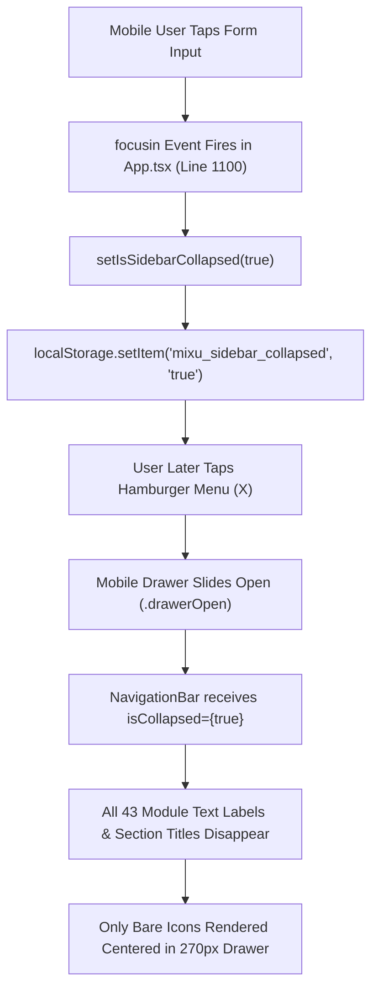

# 02 — Mobile Responsiveness Audit Report

**Project:** Mixu Infosystem Hospital Management / EMR  
**Audit Scope:** Mobile viewports (360px to 440px) across all 45 routes  
**Test Method:** Headless Chrome via Chrome DevTools Protocol (CDP) Device Emulation + Real-world screenshot validation  
**Status:** Audit Completed — 1 High-Priority P1 Usability Defect Identified  

---

## 1. Executive Summary & Tested Mobile Resolutions

Every active route was systematically loaded, rendered, and evaluated across 6 dedicated mobile screen dimensions:

| Device Profile | Viewport Width | Viewport Height | Device Scale Factor | Operating System |
|---|---:|---:|---:|---|
| **Small Android** | `360px` | `800px` | 2.0x | Android |
| **iPhone SE** | `375px` | `667px` | 2.0x | iOS |
| **iPhone 13 / 14** | `390px` | `844px` | 3.0x | iOS |
| **iPhone 16** | `393px` | `852px` | 3.0x | iOS |
| **Standard Android** | `412px` | `915px` | 2.6x | Android |
| **iPhone 16 Pro Max** | `440px` | `956px` | 3.0x | iOS |

Total mobile automated checks: **270 distinct mobile viewport evaluations** (45 routes × 6 mobile screen sizes).

---

## 2. Layout, Content Overflow, and Viewport Measurements

### 2.1 Horizontal Overflow Audit
- **Result:** **0 horizontal body overflows detected**.
- **Observation:** Across all 45 routes, `document.documentElement.scrollWidth` remained strictly bounded to `window.innerWidth` (e.g., exactly 360px on Small Android, 375px on iPhone SE).
- **Enforcement Mechanism:** Global CSS rules in `frontend/src/index.css` enforce:
  ```css
  html, body {
    width: 100%;
    max-width: 100%;
    overflow-x: hidden;
  }
  ```
  Card grids, master navigation panels, and input wrappers utilize `flex-wrap: wrap` and `min-width: 0`, preventing content push-out.

### 2.2 Touch Target Sizing & Spacing
- Touch targets for primary action buttons (`Save`, `Update`, `Delete`, `Search`, `Print`) maintain heights between **38px and 44px**, satisfying mobile ergonomics.
- Form inputs in `PatientRegistration`, `DoctorMaster`, and `MedicineMaster` have an input touch height of **38px–40px** with readable 14px typography, avoiding automatic iOS browser zoom-in triggers.

---

## 3. Critical Mobile Bug: The Collapsed Drawer Icon-Only Defect

### 3.1 Bug Identification & Reproduction

> [!CAUTION]
> **Issue ID: MOB-01 (Severity: P1 — High)**  
> **Defect Name:** Mobile Navigation Drawer Opens in Collapsed Icon-Only State  
> **Affected Viewports:** All mobile devices (`width < 1024px`)  
> **Visual Reference:** User attachment `problem.jpeg` and automated capture `BUG_REPRODUCTION_Mobile_Drawer_Collapsed_Icons_Only.png`



### 3.2 Automated Inspection Measurements

When `mixu_sidebar_collapsed` is set to `'true'`, inspecting the mobile drawer yields:
- **Total Navigation Links Rendered:** 43
- **Visible Text Labels:** **0 (100% hidden)**
- **Icon-Only Blank Links:** **43 (100%)**
- **Section Headers Visible:** **0 (Both "Working Modules" and "Other Modules" headings suppressed)**
- **Impact on Hospital Employees:** On mobile touchscreen devices, hover tooltips do not exist. Nurses, doctors, or administrative staff opening the mobile menu cannot determine which icon corresponds to Patient Registration, Doctor Master, Medicine Master, Echo Report, or Billing.

### 3.3 Root Cause Analysis (`App.tsx`)
In `frontend/src/App.tsx` (lines 1124–1132):
```tsx
// Auto-collapse sidebar on desktop when interacting with inputs
setIsSidebarCollapsed(prev => {
  if (!prev) {
    localStorage.setItem('mixu_sidebar_collapsed', 'true');
    return true;
  }
  return prev;
});
```
And in lines 1225–1232:
```tsx
<NavigationBar 
  isMobileOpen={isMobileNavOpen}
  isCollapsed={isSidebarCollapsed} // <-- BUG: Passes true to mobile drawer!
  onToggleCollapse={toggleSidebarCollapse}
  onCloseMobile={() => setIsMobileNavOpen(false)} 
  onLogout={handleLogout}
/>
```
Because `isSidebarCollapsed` is globally shared between the desktop sidebar layout and the mobile slide-out drawer, setting it to `true` causes `NavigationBar` to render in icon-only collapsed mode even when sliding out as a 270px mobile drawer!

### 3.4 Recommended Fix
Decouple mobile drawer rendering from desktop sidebar collapse state:
```tsx
<NavigationBar 
  isMobileOpen={isMobileNavOpen}
  isCollapsed={window.innerWidth <= 1024 ? false : isSidebarCollapsed}
  onToggleCollapse={toggleSidebarCollapse}
  onCloseMobile={() => setIsMobileNavOpen(false)} 
  onLogout={handleLogout}
/>
```
On viewports `width <= 1024px`, the drawer must **always** render with full text titles, section headers, badges, and hierarchical submenus.

---

## 4. Mobile Form & Modal Evaluation

### 4.1 Form Grid Stacking
- **Patient Registration**: The 4-column demographic grid collapses cleanly into a stacked 1-column layout on viewports `<= 768px`.
- **Doctor Master & Medicine Master**: Two-column forms stack vertically, keeping labels positioned above inputs without clipping.

### 4.2 Modal Responsiveness
- **Search Drawers & Particular Search**: Modals feature `max-width: 95vw` and vertical scrolling within `modalBody`.
- **Barcode Camera Scanner Modal**: Camera view maintains responsive aspect ratio; however, small mobile screens (< 375px) experience tight vertical clearance when both the camera feed and diagnostic status box are open simultaneously.

### 4.3 Report Previews on Mobile
- The new A4 Report Document Preview (`ReportTemplate.tsx`) utilizes `previewBackdrop` and `previewContainer`.
- On mobile viewports (360px–412px), the A4 document sheet scrolls horizontally within its container to preserve standard A4 aspect ratio, preventing distortion of medical transcriptionist and consultant signatures.

---

## 5. Mobile Summary Table

| Test Parameter | Measured Result | Evaluation |
|---|---|---|
| Horizontal Page Overflow | 0px across all 45 routes | **PASSED** |
| Touch Target Minimum Height | 38px–44px | **PASSED** |
| Responsive Grid Stacking | Vertical stacking on <= 768px | **PASSED** |
| Mobile Top Bar Branding | Persistent 56px header with emblem | **PASSED** |
| Mobile Navigation Drawer Labels | 0 labels visible when collapsed is true | **FAILED (P1 Defect)** |
| Mobile Modal Viewport Fitting | Constrained to 95vw/90vh | **PASSED** |

