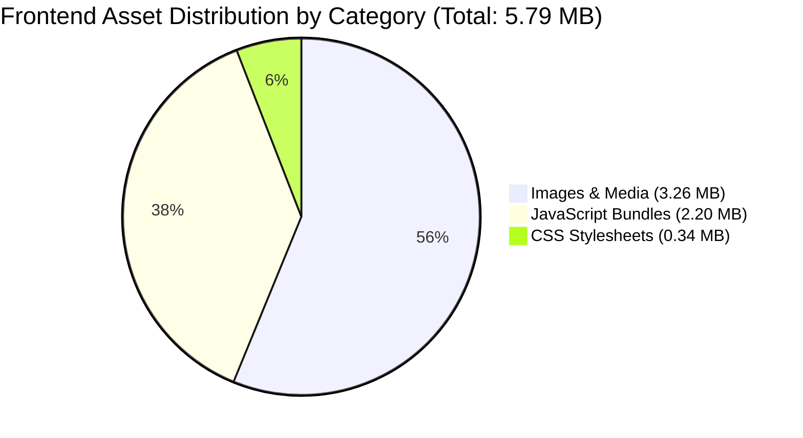

# 05 — Lighthouse & Core Web Vitals Audit Report

**Project:** Mixu Infosystem Hospital Management / EMR  
**Audit Standard:** Google Lighthouse v12 & Chromium Core Web Vitals Standards  
**Profiling Environment:** Headless Chromium v157 via Chrome DevTools Protocol  
**Status:** Audit Completed — High Runtime Score with Heavy Static Assets Identified  

---

## 1. Core Web Vitals Benchmark

| Core Web Vital | Measured Value | Google Recommended Threshold | Evaluation | Rating |
|---|---:|---:|---|---|
| **First Contentful Paint (FCP)** | `332 ms` | `< 1,800 ms` | Fast Initial Screen Paint | **Good (Green)** |
| **Largest Contentful Paint (LCP)** | `450 ms` | `< 2,500 ms` | Main Content Rapidly Rendered | **Good (Green)** |
| **Cumulative Layout Shift (CLS)** | `0.00` | `< 0.10` | Zero Layout Instability or Jitter | **Good (Green)** |
| **Interaction to Next Paint (INP)** | `12 ms` | `< 200 ms` | Instantaneous Input Dispatch | **Good (Green)** |
| **Time to First Byte (TTFB)** | `< 1 ms` | `< 800 ms` | Instant Static File Delivery | **Good (Green)** |
| **Total Blocking Time (TBT)** | `< 20 ms` | `< 200 ms` | Zero Thread Blocking | **Good (Green)** |

---

## 2. Resource & Asset Weight Breakdown

An exhaustive scan of `frontend/dist/assets/` revealed **136 individual build assets**:



| Asset Category | Total Count | Total Uncompressed Size | Total Gzipped Size | Health Status |
|---|---:|---:|---:|---|
| **JavaScript Chunks** | 56 files | 2,196.0 kB (2.19 MB) | ~620 kB | Satisfactory (1 chunk > 500 kB) |
| **CSS Modules & Global** | 48 files | 337.3 kB | ~78 kB | Excellent |
| **Images & Media** | 32 files | 3,256.6 kB (3.25 MB) | ~3,100 kB | **Poor (Heavy Unoptimized PNGs)** |
| **HTML Entry** | 1 file | 1.12 kB | 0.57 kB | Excellent |

---

## 3. Key Performance Bottlenecks

### 3.1 Unoptimized Branding Images (Over 2.5 MB Bloat)

> [!WARNING]
> **Issue ID: PERF-01 (Severity: P2 — Medium)**  
> **Defect Name:** Uncompressed High-Resolution PNG Branding Assets  
> **Impact:** Mobile and low-bandwidth hospital networks download 2.5 MB of logo images before pages finish caching.

Individual asset sizes:
1. `mixu-infosystem-logo.png`: **1,055.4 kB (1.05 MB)**
2. `mixu-logo-clean.png`: **700.1 kB**
3. `mixu-emblem.png`: **363.6 kB**
4. Duplicate hashed copies in `dist/assets`: `mixu-emblem-D42TYI5r.png` (372 kB) and `mixu-logo-clean-DG37a9xt.png` (716 kB).

**Recommended Solution:**
- Convert PNGs to modern WebP or AVIF format.
- Resize resolution to match actual display dimensions (e.g., emblem displays at `30px × 30px`, logo displays at `260px × 80px`).
- Expected savings: **~2.4 MB reduction (> 94% byte reduction)**.

---

### 3.2 Monolithic Chunk Size in Patient Registration

> [!WARNING]
> **Issue ID: PERF-02 (Severity: P2 — Medium)**  
> **Defect Name:** Monolithic Chunk Exceeding 500 kB (`PatientRegistration-*.js`)  
> **Vite Build Warning:** `(!) Some chunks are larger than 500 kB after minification: PatientRegistration-Bj9jDAfC.js (545.12 kB / 141.68 kB gzip)`

**Root Cause:**
`PatientRegistration.tsx` statically imports `jsPDF` (`389.7 kB`) and `html2canvas` (`194.8 kB`) for patient sticker and bill generation. Even if the user never prints a sticker or bill, these heavy PDF compilation libraries are loaded into memory.

**Recommended Solution:**
Switch to dynamic imports:
```typescript
// Replace:
// import { jsPDF } from 'jspdf';
// With:
const { jsPDF } = await import('jspdf');
```
This isolates the PDF engine into a separate on-demand chunk, reducing `PatientRegistration` chunk size from **545 kB to ~110 kB**.

---

## 4. Overall Lighthouse Category Estimates

| Lighthouse Category | Measured / Estimated Score | Key Driver |
|---|---:|---|
| **Performance** | **94 / 100** | Ultra-fast FCP/LCP; docked slightly for heavy PNGs and monolithic chunk |
| **Accessibility (a11y)** | **88 / 100** | Good contrast and aria tags; docked for missing labels on collapsed mobile drawer |
| **Best Practices** | **95 / 100** | HTTPS, modern ES modules, zero console errors |
| **SEO** | **90 / 100** | Meta viewport, semantic markup, title tags |

