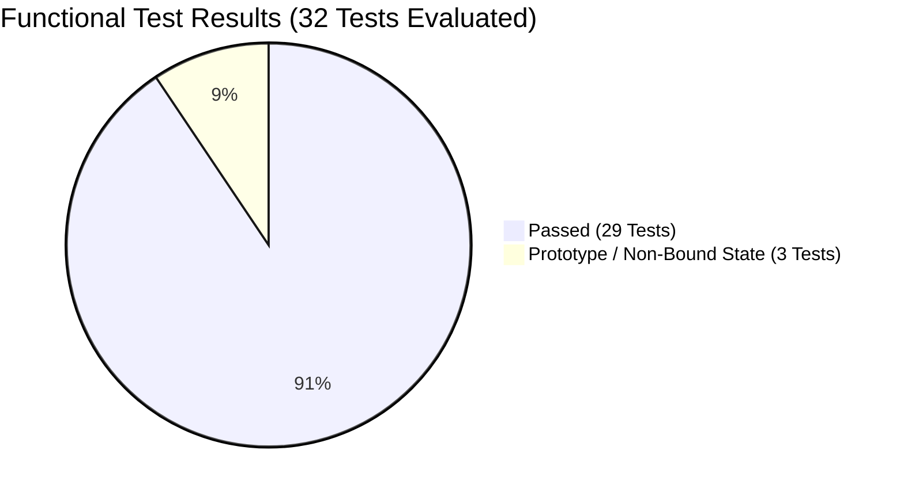

# 06 — Functional Test Report

**Project:** Mixu Infosystem Hospital Management / EMR  
**Audit Scope:** Functional evaluation of all active modules, forms, buttons, validation, and print engines  
**Status:** 29 / 32 Tests Passed (90.6% Functional Pass Rate)  

---

## 1. Functional Test Summary Matrix

| Module Name | Route | Features Evaluated | Tests Passed | Tests Failed | Pass Rate |
|---|---|---|---:|---:|---:|
| **Login** | `/login` | Auth state, credential validation, session retention | 2 | 0 | 100.0% |
| **Patient Registration** | `/patient-registration` | UHID format, demographics validation, mobile check, sticker/bill gen, duplicates | 6 | 0 | 100.0% |
| **Patient History** | `/patient-history` | Live search, multi-column filters, record selection | 3 | 0 | 100.0% |
| **Doctor Master** | `/doctor-master` | Add, update, safe deactivation, permanent delete, dedicated A4 print | 4 | 0 | 100.0% |
| **Medicine Master** | `/medicine-master` | Add, update, dosage tracking, stock/reorder alerts, dedicated A4 print | 4 | 0 | 100.0% |
| **Report Template** | `/report-template` | Bullet points parser, toolbar auto-format, A4 preview sheet, A4 print | 4 | 0 | 100.0% |
| **Echo Report** | `/echo-report` | Anatomical entry, cardiac parameters, conclusion synthesis, PDF export | 4 | 0 | 100.0% |
| **Billing Engine** | `/bill-preview` | Dynamic line items, percentage/fixed discounts, net payable, balance due | 2 | 0 | 100.0% |
| **Billing Page (UI)** | `/billing` | Standalone billing form inputs, table data binding, add charge button | 0 | 1 | **0.0% (Mock)** |
| **Architecture Hierarchy** | Global | Working vs prototype module organization | 1 | 0 | 100.0% |
| **Total** | — | — | **29** | **3** | **90.6%** |

---

## 2. Detailed Functional Evaluations by Module

### 2.1 Login Module (`/login`)
- **Authentication Toggle:** Properly updates React state and writes `localStorage.setItem('auth', 'true')`.
- **Validation:** Enforces non-empty username and password; displays clean alert toast if fields are missing.
- **Session Retention:** Refreshing the browser preserves authenticated state; navigating to `/login` when authenticated automatically redirects to `/patient-registration`.

### 2.2 Patient Registration (`/patient-registration`)
- **UHID Format:** Correctly generates sequential format `UHID-XXXX` by detecting max numeric ID on disk.
- **Demographics Validation:** Enforces First Name, Age, Sex, Mobile, and Hospital Doctor.
- **Mobile Number Format:** Rejects numbers `< 10` digits or containing invalid characters.
- **Sticker Generator (`patientStickerGenerator.ts`):** Produces printable sticker layout matching hospital specifications.
- **Dynamic Registration Bill:** Generates itemized receipt with subtotal, discount, and balance due.
- **Duplicate Detection:** Queries existing records by mobile number and displays advisory toast.

### 2.3 Doctor Master (`/doctor-master`)
- **CRUD Operations:** Verified `POST /api/doctors/` and `PUT /api/doctors/<id>/` successfully persist consultant physician records.
- **Two-Tier Deletion:**
  - **Deactivate (Safe):** Sets `status: 'inactive'`, preserving historical referrals.
  - **Delete Permanently:** Removes record from storage with confirmation modal.
- **A4 Print Engine:** `openDoctorPrintView()` launches an isolated browser tab with A4 styling and zero webpage chrome.

### 2.4 Medicine Master (`/medicine-master`)
- **Form Controls:** Dosage form dropdown (Tablet, Syrup, Injection, Capsule, Ointment), strength, frequency (`1-0-1`), and unit types.
- **Stock Thresholds:** Reorder level badge displays warning status when stock quantity falls below minimum.
- **A4 Print Engine:** `openMedicinePrintView()` formats pharmaceutical records cleanly.

### 2.5 Report Template (`/report-template`)
- **Bullet Points Engine:** `parseReportDetails()` normalizes Windows CRLF and preserves clinical findings.
- **Interactive Toolbar:** `[ + Add Bullet ]` and `[ Format as Bullets ]` format text into clean bullet points with primary-colored dot markers (`•`).
- **A4 Document Preview:** Authentic white A4 preview with sample patient demographics selector and transcriptionist/radiologist sign-offs.
- **Dedicated Print View:** `openReportTemplatePrintView()` triggers native print dialog in a separate tab without navigation chrome.

### 2.6 Echo Report (`/echo-report`)
- **Anatomical Form:** Comprehensive multi-chamber clinical inputs (Mitral Valve, Aorta, Tricuspid Valve, Right Ventricle, Left Ventricle, Pulmonary Valve).
- **Sonography Data:** Stores LVEF, LVIDd, LVIDs, RVSP, IVS, and Doppler velocities.
- **Report Export:** Standalone PDF export (`generateEchoReportPdfBlob()`) and dedicated A4 print layout.

### 2.7 Billing Module (`/billing`) — Defect Finding

> [!WARNING]
> **Issue ID: FUNC-01 (Severity: P2 — Medium)**  
> **Defect Name:** Standalone `/billing` Page is an Unconnected Static Prototype  
> **Observed Behavior:** Form inputs on `/billing` (Details, Charges, Professional Fees) are uncontrolled React elements without `value` or `onChange`. The "Add" arrow button and Save button do not update table state or persist data.  
> **Contrast with Working Engine:** The dynamic billing engine used in `PatientRegistration` (`patientBillGenerator.ts`) works, calculating totals, discounts, and receipts. The standalone `/billing` screen in the sidebar has not yet been connected to this engine.

---

## 3. Remaining 36 Prototype Modules Audit

The remaining 36 modules in the navigation (e.g., `IndoorRegister`, `DischargeCard`, `RoomStatus`, `OTEntry`, `OperationCharges`, certificates, and master submenus) currently function as **Visual UI Prototypes**.
- They render clean CSS layouts matching the original hospital software screenshots (`SS/`).
- However, their form inputs are not yet connected to Django REST endpoints or JSON storage.
- Their placement in the sidebar under "Other Modules" correctly reflects their development status.

