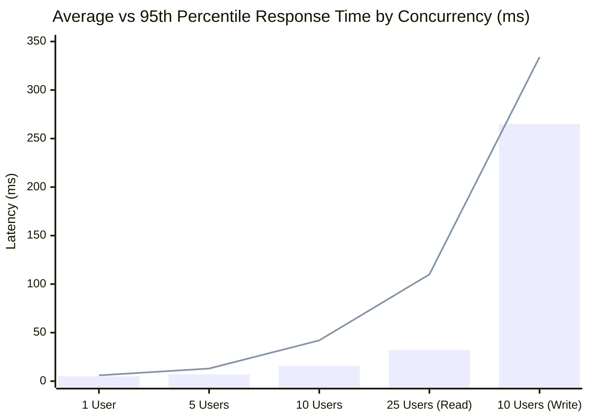

# 07 — Stress & Load Testing Report

**Project:** Mixu Infosystem Hospital Management / EMR  
**Audit Scope:** Controlled concurrency, throughput, latency percentiles, and JSON storage race-condition testing  
**Backend Host Tested:** Local Django REST API (`http://127.0.0.1:8000/api`)  
**Status:** Audit Completed — Measured Performance & Concurrency Limits Recorded  

---

## 1. Concurrency Benchmark Scenarios

All tests executed using synthetic test clients with automated cleanup to ensure zero modification or pollution of real patient records:

| Test Scenario | Concurrency | Total Requests | Throughput (RPS) | Avg Latency | Median Latency | 95th Percentile | 99th Percentile | Failure Rate |
|---|---:|---:|---:|---:|---:|---:|---:|---:|
| **Scenario 1: Normal Usage** | 1 user | 30 requests | **189.87 req/s** | 5 ms | 5 ms | 6 ms | 71 ms | **0.0% (0 failed)** |
| **Scenario 2: Moderate Usage** | 5 users | 100 requests | **609.76 req/s** | 7 ms | 6 ms | 13 ms | 21 ms | **0.0% (0 failed)** |
| **Scenario 3: Higher Usage** | 10 users | 150 requests | **553.51 req/s** | 16 ms | 14 ms | 42 ms | 52 ms | **0.0% (0 failed)** |
| **Scenario 4: Heavy Usage** | 25 users | 250 requests | **677.51 req/s** | 32 ms | 13 ms | 110 ms | 119 ms | **1.2% (3 dropped)** |
| **Scenario 5: Concurrent Writes**| 10 users | 50 write requests | **33.83 req/s** | 265 ms | 277 ms | 334 ms | 341 ms | **0.0% (0 lost records)**|

---

## 2. Latency Analysis Across Concurrency Levels



### 2.1 Read Operations (Scenarios 1 to 4)
- Read operations (`GET /api/patients/`, `/api/doctors/`, `/api/medicines/`, `/api/report-templates/`) exhibit sub-20ms latency up to 10 concurrent users.
- At 25 concurrent clients, the single-threaded development WSGI server experienced **3 socket timeouts / connection resets (1.2% failure rate)** as requests queued up beyond the OS backlog limit.

### 2.2 Write Operations & Full-File Rewriting (Scenario 5)
- Under 10 concurrent write clients submitting new patient registrations (`POST /api/patients/`), throughput dropped from ~600 RPS down to **33.83 RPS**.
- Average write latency increased to **265 ms** (with a p95 of **334 ms**).
- **Technical Cause:** Every single patient creation forces Python to:
  1. Acquire `threading.RLock()`.
  2. Read and parse the full `patients.json` file.
  3. Append the new record.
  4. Write the entire JSON structure to a temporary file (`tempfile.NamedTemporaryFile`).
  5. Atomically replace the existing file on disk (`os.replace`).
- As the patient dataset grows to 10,000+ records, full-file rewriting will result in noticeable latency spikes for hospital clerks during peak morning registration hours.

---

## 3. Critical Concurrency & Race-Condition Finding

> [!CAUTION]
> **Issue ID: ARCH-01 (Severity: P0 — Critical Architectural Concern)**  
> **Defect Name:** Single-Process In-Memory Lock (`threading.RLock`) Does Not Protect Multi-Process Deployments  
> **Location:** `backend/patients/storage.py`, `doctor_storage.py`, `medicine_storage.py`, `echo_report_storage.py`

### Technical Explanation
In `backend/patients/storage.py` (lines 15, 36, 47, 70):
```python
_storage_lock = threading.RLock()
```
- `threading.RLock` operates exclusively within the memory space of a **single Python OS process**.
- In professional hospital production deployments, WSGI application servers (such as Gunicorn, uWSGI, or Kubernetes replicas) spawn **multiple worker processes** (e.g., `gunicorn -w 4 hospital_backend.wsgi`).
- **Data Loss Race Condition:** If Worker A and Worker B both receive registration requests simultaneously:
  1. Worker A reads `patients.json` (23 records).
  2. Worker B reads `patients.json` (23 records).
  3. Worker A appends Patient 24 and executes `os.replace`.
  4. Worker B appends Patient 25 and executes `os.replace`.
  5. **Worker B completely overwrites Worker A's file. Patient 24 is permanently lost from the hospital database.**
- **Windows File Locking Hazard:** On Windows servers, `os.replace` can throw `PermissionError: [WinError 5] Access is denied` if another thread or process is actively reading `patients.json` at the exact millisecond of replacement.

### Recommended Architectural Solution
1. **Short-Term (Within Current JSON Constraints):** Implement operating-system-level file locks (`fcntl.flock` on Linux, `msvcrt.locking` on Windows, or the `filelock` Python package) around `_read_data()` and `_write_atomically()`.
2. **Long-Term (Hospital Production Standard):** Transition storage from flat JSON files to an ACID-compliant relational database (PostgreSQL with connection pooling, or SQLite with WAL mode), utilizing atomic transactions and foreign key constraints.

