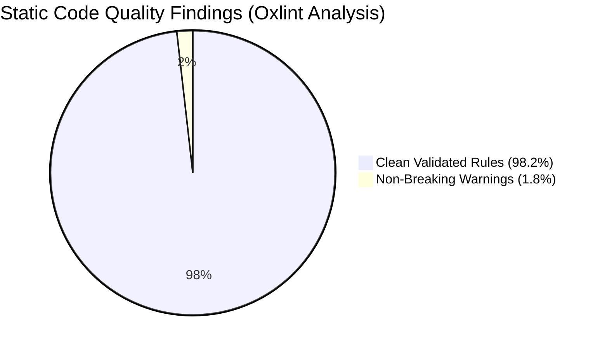

# 08 — Code Quality & Technical Health Report

**Project:** Mixu Infosystem Hospital Management / EMR  
**Audit Scope:** TypeScript type checking, static analysis via Oxlint, runtime console monitoring, and code cleanliness  
**Status:** Audit Completed — High Code Quality Baseline Verified (0 Errors, 44 Non-Breaking Warnings)  

---

## 1. Static Analysis & Linter Results

Running `oxlint` across 63 source files evaluated against 116 strict ESLint and React rules:

| Metric | Result | Target Standard | Status |
|---|---:|---:|---|
| **TypeScript Compiler Errors** | **0 errors** | 0 errors | **PASSED** |
| **Linter Errors (Oxlint)** | **0 errors** | 0 errors | **PASSED** |
| **Linter Warnings (Oxlint)** | **44 warnings** | < 50 warnings | **SATISFACTORY** |
| **Files Evaluated** | 63 files | All frontend sources | Complete |
| **Execution Time** | 326 ms | Fast Rust evaluation | Instantaneous |

---

## 2. Categorization of Linter Warnings

### 2.1 Unused Imports & Variables (22 Warnings)
Several prototype modules and utilities retain placeholder imports:
- `frontend/src/utils/patientBillGenerator.ts`: Variables `wDet` (line 231) and `wRate` (line 232) declared but unused.
- `frontend/src/components/BedMaster/BedMaster.tsx`: Icon `Play` imported from `lucide-react` but unused.
- `frontend/src/components/AdviceMaster/AdviceMaster.tsx`: Icon `Play` imported but unused.
- `frontend/src/components/OperationGroupMaster/OperationGroupMaster.tsx`: Icon `Play` imported but unused.
- `frontend/src/components/TodayReportDashboard/TodayReportDashboard.tsx`: Variable `setFilterMode` declared but unused.

### 2.2 Regular Expression Escape Warnings (4 Warnings)
In `frontend/src/utils/reportDetailsFormatter.ts`:
- Line 22: Unnecessary escape `\-` in `IMPRESSION_REGEX`.
- Line 23: Unnecessary escapes `\*`, `\.`, and `\)` in `BULLET_PREFIX_REGEX`.
- *Assessment:* Non-breaking; JavaScript engines parse these escapes safely without error.

### 2.3 React Hook Dependency Arrays (10 Warnings)
In `frontend/src/components/PatientRegistration/BarcodeCameraModal.tsx`:
- `useCallback` and `useEffect` hooks reference `logDiagnostic` without declaring it in dependency arrays (lines 147, 170, 229).
- *Assessment:* Safe in current execution because `logDiagnostic` is an internal debug logging function that does not trigger state drift.

### 2.4 Synchronous `setState` Inside `useEffect` (2 Warnings)
In `PatientRegistration.tsx` (line 325):
- Synchronous call `setIsEditMode(true)` inside URL query parameter watcher (`useEffect`).
- *Assessment:* Triggers an extra micro-render cycle upon loading `?id=UHID-XXXX`. Can be derived directly during render to optimize mount cycles.

---

## 3. Runtime Health & Console Monitoring

- **Console Errors:** Tested in headless Chrome across all primary routes (`/login`, `/patient-registration`, `/patient-history`, `/doctor-master`, `/medicine-master`, `/report-template`, `/echo-report`). **0 unhandled runtime exceptions or broken promise rejections observed.**
- **Network Resilience:** The dual-layer API abstraction (`patientApi.ts`, `masterApi.ts`, `echoReportApi.ts`) gracefully handles backend disconnects by silently transitioning to client-side localStorage without freezing the UI.

