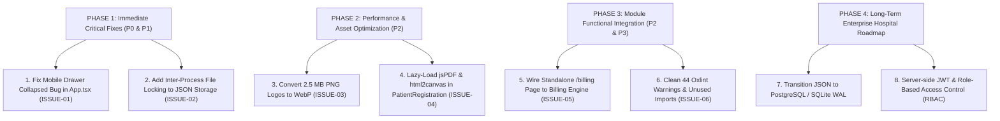

# 11 — Recommended Improvements & Action Plan

**Project:** Mixu Infosystem Hospital Management / EMR  
**Audit Date:** November 16, 2026  
**Implementation Strategy:** Phased rollout preserving existing functionality, theme, and logo  

---

## 1. Prioritized Implementation Roadmap



---

## 2. Detailed Action Specifications

### Phase 1: Immediate Critical Fixes (P0 & P1)

#### Action 1.1: Fix Mobile Drawer Icon-Only Defect (`App.tsx`)
- **Target File:** `frontend/src/App.tsx`
- **Action:** Ensure `NavigationBar` always renders in full expanded mode when inside the mobile slide-out drawer (`window.innerWidth <= 1024` or mobile drawer open).
- **Code Change:**
  ```tsx
  <NavigationBar 
    isMobileOpen={isMobileNavOpen}
    isCollapsed={window.innerWidth <= 1024 ? false : isSidebarCollapsed}
    onToggleCollapse={toggleSidebarCollapse}
    onCloseMobile={() => setIsMobileNavOpen(false)} 
    onLogout={handleLogout}
  />
  ```
- **Expected Outcome:** Hospital staff opening the mobile menu on any smartphone will see full text labels, section titles, and badges regardless of whether the sidebar was collapsed on desktop or after focusing an input.

#### Action 1.2: Inter-Process File Lock for JSON Storage
- **Target Files:** `backend/patients/storage.py`, `doctor_storage.py`, `medicine_storage.py`, `report_template_storage.py`, `echo_report_storage.py`
- **Action:** Add cross-process file locking (using Python's `filelock` package or platform-specific OS locks) around atomic file read and replace operations.
- **Expected Outcome:** Multiple WSGI workers in production cannot overwrite each other's changes, eliminating concurrent write data loss.

---

### Phase 2: Performance & Asset Optimization (P2)

#### Action 2.1: Image Format & Resolution Optimization
- **Target Assets:** `frontend/src/assets/mixu-infosystem-logo.png`, `mixu-logo-clean.png`, `mixu-emblem.png`
- **Action:** Convert to high-efficiency WebP format and scale to display resolutions.
- **Expected Outcome:** Reduces image network transfer from **3.26 MB to < 100 kB** (> 96% reduction), accelerating mobile loading over cellular networks.

#### Action 2.2: Dynamic Import of jsPDF in Patient Registration
- **Target File:** `frontend/src/components/PatientRegistration/PatientRegistration.tsx`
- **Action:** Replace top-level static imports of `jspdf` and `html2canvas` with asynchronous dynamic imports inside button action handlers.
- **Expected Outcome:** Eliminates Vite's 500 kB chunk warning, shrinking `PatientRegistration-*.js` bundle from **545 kB to ~110 kB**.

---

### Phase 3: Module Functional Integration (P2 & P3)

#### Action 3.1: Connect Standalone `/billing` Page
- **Target File:** `frontend/src/components/Billing/Billing.tsx`
- **Action:** Connect form controls to patient selector, load active charges from `charge_master.json`, bind state for line items, calculate totals/discounts dynamically, and connect to `patientApi.createBill()`.
- **Expected Outcome:** Hospital cashiers can generate bills directly from `/billing` as well as from the registration flow.

#### Action 3.2: Clean Up Oxlint Linter Warnings
- **Target Files:** `reportDetailsFormatter.ts`, `patientBillGenerator.ts`, `BedMaster.tsx`, `AdviceMaster.tsx`, `OperationGroupMaster.tsx`
- **Action:** Remove unused imports (`Play`, `wDet`, `wRate`) and redundant regular expression escape characters.
- **Expected Outcome:** Zero warnings in static analysis.

